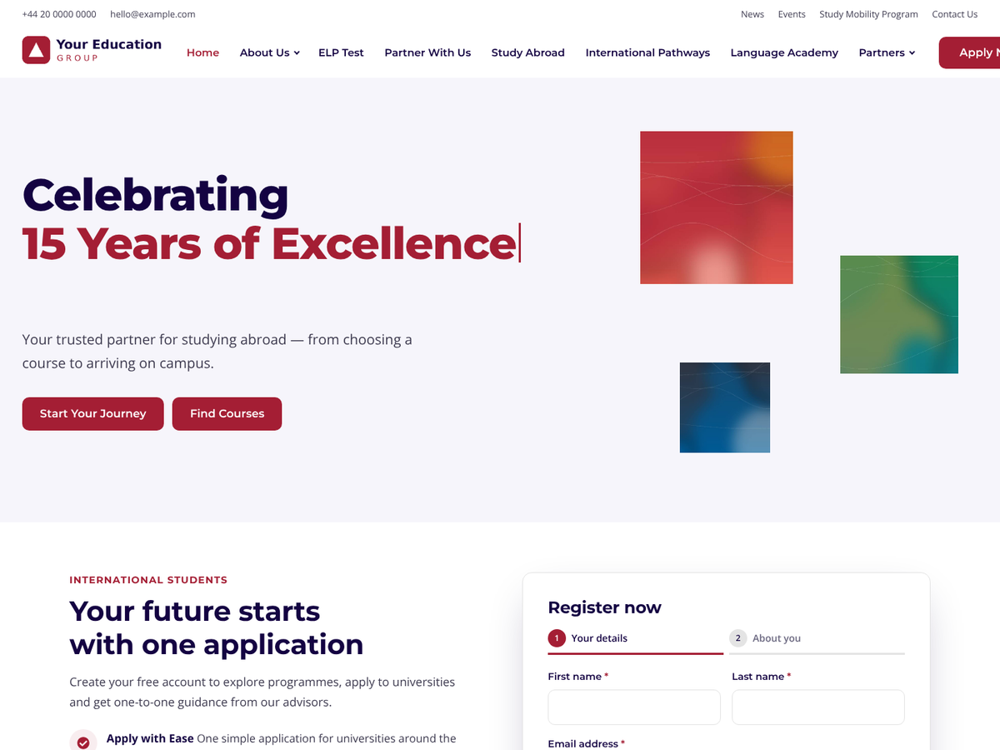
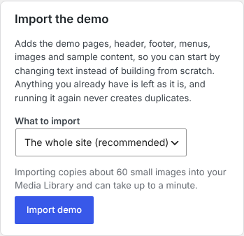
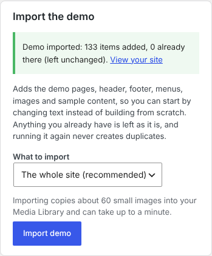
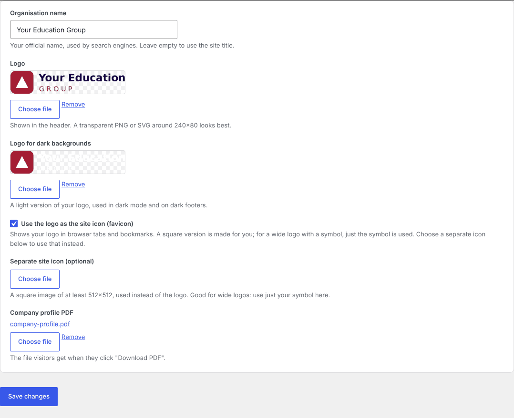
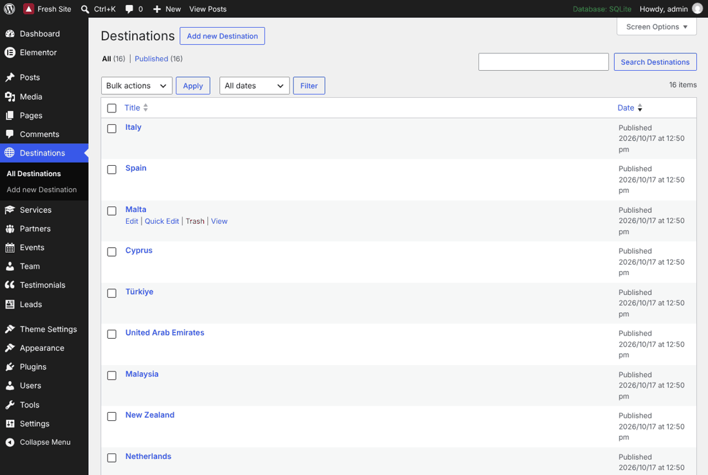
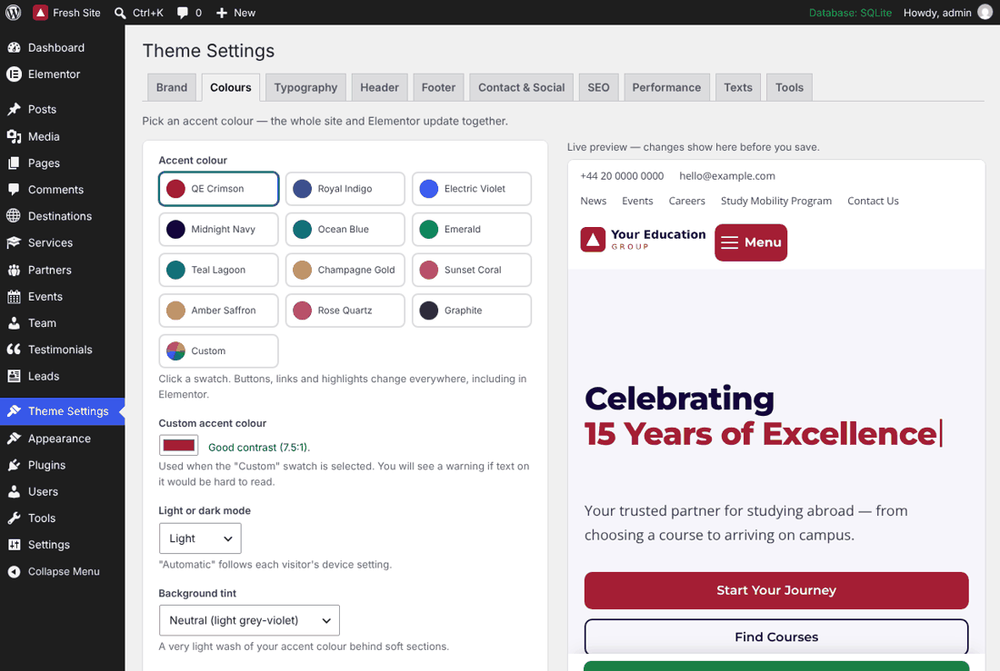
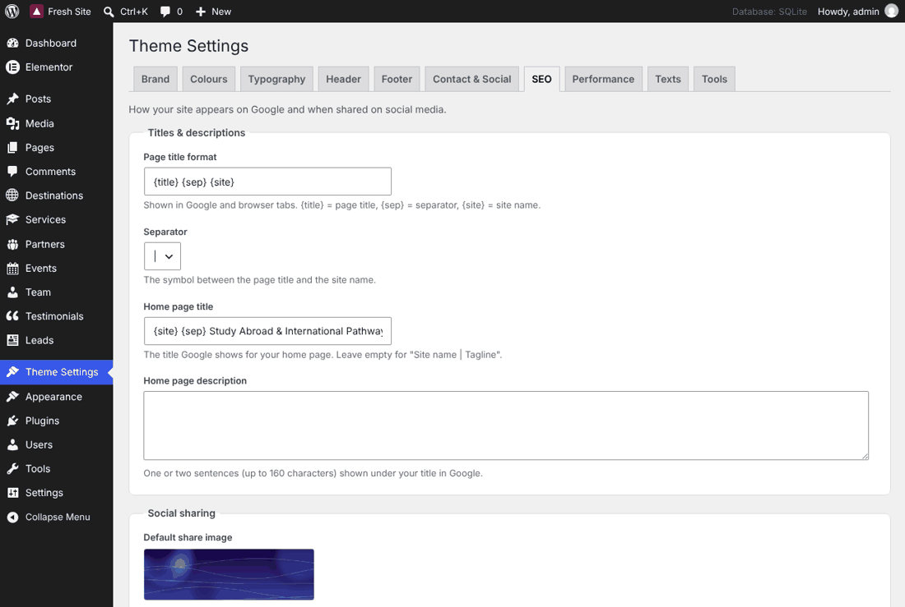

# QE Edu — education & study‑abroad theme for Elementor

A premium WordPress theme (**QE Edu**) and its companion plugin (**QE Edu Core**) for
universities, colleges, study‑abroad agencies and language schools. Every page, header,
footer and text is editable in Elementor or in **Theme Settings** — no code, no shortcodes.



**What you get**

- 18 ready‑made pages, plus header, footer, 404, blog‑post and archive designs, all built
  with Elementor and importable in one click.
- 20 custom Elementor widgets (animated hero, registration form, sliders, destinations,
  mega menu, events, FAQ, team, testimonials and more).
- **Theme Settings** panel: logo and site icon, 12 accent colours (plus your own), light/dark
  mode, 12 font pairings, header and footer options, contact details, SEO, analytics,
  performance and every small text the theme shows.
- Built‑in SEO (titles, descriptions, social sharing, schema, sitemap, redirects, 404 log)
  that steps aside automatically if you use Yoast SEO or Rank Math.
- Fast and accessible: Lighthouse mobile 93–98 performance, 100 accessibility, 100 SEO on
  the demo pages (see [Performance](#performance)).

---

## Contents

1. [Requirements](#requirements)
2. [Install](#install)
3. [Import the demo](#import-the-demo)
4. [How to edit your site](#how-to-edit-your-site) — a short guide for every common task
5. [Colours, fonts and dark mode](#colours-fonts-and-dark-mode)
6. [SEO setup](#seo-setup)
7. [Performance](#performance)
8. [Child themes and customisation](#child-themes-and-customisation)
9. [Troubleshooting](#troubleshooting)
10. [For developers](#for-developers)
11. [Credits and licence](#credits-and-licence)

---

## Requirements

| | Minimum |
|---|---|
| WordPress | 6.6 (tested up to 7.1) |
| PHP | 8.1 |
| Elementor (free) | 3.24 or newer (tested with 4.3). Elementor Pro is optional. |

---

## Install

You receive two files: **`qe-edu.zip`** (the theme) and **`qe-edu-core.zip`** (the plugin).

1. **Theme:** *Appearance → Themes → Add New → Upload Theme* → choose `qe-edu.zip` →
   **Install Now** → **Activate**.
2. **Plugins:** a notice at the top of the dashboard lists what the theme needs:
   - **Elementor** → click *Install* in the notice (or *Plugins → Add New*, search "Elementor").
   - **QE Edu Core** → *Plugins → Add New → Upload Plugin* → choose `qe-edu-core.zip` →
     **Install Now** → **Activate**.
3. A new **Theme Settings** item appears in the left menu. You're ready to import the demo.

> Building the zips yourself? Run `npm run zip` — they appear in `dist/`.

---

## Import the demo

The demo gives you a complete website to start from: pages, header, footer, menus,
images, sample destinations, services, partners, events, team members, testimonials and
news posts.

1. Go to **Theme Settings → Tools**.
2. In **Import the demo**, keep **The whole site (recommended)** selected and click
   **Import demo**. It takes up to a minute.

   

3. When it's done you'll see how many items were added and a link to view your site.

   

**Good to know**

- **Nothing of yours is overwritten.** The import only adds what is missing. A page you
  already have with the same address (for example your own "About" page) is kept as it is.
- **Running it again never creates duplicates.** Deleted a demo page by mistake? Import
  again, or choose just that page in **What to import** to bring back only that one.
- The demo sets your home page, the news (blog) page, the menus and the header/footer
  designs, but only where you haven't chosen your own yet.
- The demo images are original artwork included with the theme; you can use or replace them freely.
- Developers can also run `wp qe-edu demo-import` (or `--page=contact` for one page).

---

## How to edit your site

| I want to change… | Where |
|---|---|
| Any text, image, button or link on a page | Open the page → **Edit with Elementor** → click the element |
| Logo, site icon (favicon), site name | **Theme Settings → Brand** |
| The header, mega menu or top bar | **Elementor → Templates → "Header"**, or *Appearance → Menus* for the links |
| The footer (columns, newsletter text, legal links, copyright) | **Elementor → Templates → "Footer"** |
| The accent colour | **Theme Settings → Colours** → click a swatch |
| Light or dark mode | **Theme Settings → Colours → Light or dark mode** |
| Fonts | **Theme Settings → Typography** |
| Destinations, services, partner logos, events, team, testimonials | The matching item in the left menu |
| A page's Google title, description or share image | The **SEO** box under the page editor (or Elementor → ⚙ Page settings → SEO) |
| Phone, email, address, WhatsApp, social links, map | **Theme Settings → Contact & Social** |
| The "Download PDF" company profile | **Theme Settings → Brand → Company profile PDF** |
| Small theme texts (404 page, search, "Read more"…) | **Theme Settings → Texts** |

### Edit a page

1. *Pages* → hover the page → **Edit with Elementor**.
2. Click any text, image or button and change it in the left panel. Widget options are
   in plain language ("Moving words", "Button text", "Show 4 per row"…).
3. Click **Publish** (or **Update**).

While you're logged in, small **"Edit this page / Edit header / Edit footer"** buttons
appear at the bottom left of your site — click one to jump straight into Elementor.

### Logo and site icon (favicon)

**Theme Settings → Brand**



- **Logo** — click *Choose file* and pick or upload your logo (a transparent PNG or SVG
  around 240×80 looks best). It appears in the header straight away.
- **Logo for dark backgrounds** — a light version, used in dark mode and on the dark footer.
- **Use the logo as the site icon (favicon)** — on by default. Your logo is shown in browser
  tabs and bookmarks. A square version is made for you automatically: for a wide logo with
  a symbol (like the demo logo) just the symbol is used, so it stays readable at tiny sizes.
- **Separate site icon (optional)** — choose a square image (at least 512×512) if you'd
  rather use something else. It always wins over the logo.
- Click **Save changes**. The logo and icon are also updated in *Appearance → Customize →
  Site Identity*, so everything stays in sync.

### Header, menu and top bar

- **Menu links:** *Appearance → Menus* → "Main menu". Drag items to reorder; drag an item
  slightly right to make it a drop‑down. In each item you can also add a short description
  and an image, which turn the drop‑down into a "mega menu".
- **Layout and design:** *Elementor → Templates* → **Header** → *Edit with Elementor*.
- **Top bar links:** *Appearance → Menus* → "Top bar".
- **Header options** (sticky header, transparent header, "Apply Now" button text and link,
  mobile menu style): **Theme Settings → Header**.

On phones the menu becomes a full‑screen panel with large tap targets; it closes with the
menu button or the *Esc* key.

### Footer

*Elementor → Templates* → **Footer** → *Edit with Elementor*. The copyright line uses the
text from **Theme Settings → Footer → Copyright** (`{year}` and `{site}` are filled in for
you). The sticky "Apply / WhatsApp" bar on phones is set up under **Theme Settings → Footer**.

### Destinations, services, partners, events, team and testimonials

Each has its own item in the left menu. Click **Add New**, fill in the title, a short text,
the image ("Featured image") and the few fields underneath (for example the event date
and venue). The matching widgets on your pages update automatically — no need to edit the
pages.



### Forms and leads

The registration and contact forms save every submission under **Leads** (and email you,
if set in the widget). On the Leads screen, **Download all as CSV (Excel)** exports them. Forms are protected
by a hidden spam trap and a rate limit.

### Every small text

Texts the theme shows outside your Elementor pages (404 page, search results, "Previous /
Next", "Read more", "Posted on"…) are listed in **Theme Settings → Texts**. Leave a box
empty to keep the default shown in grey.

---

## Colours, fonts and dark mode

**Theme Settings → Colours**



- Click one of the **12 accent colours** — the live preview on the right updates before you
  save. Buttons, links and highlights change everywhere, including Elementor's **Global
  Colours**, so Elementor widgets follow too.
- **Custom** lets you pick any colour; the screen tells you if text on it would be hard to read.
- **Light or dark mode:** *Light*, *Dark*, or *Automatic* (follows each visitor's device).
- **Button shape:** rounded, pill or square — for every button, including Elementor's.

**Theme Settings → Typography** offers 12 tested heading/body font pairs. The fonts are
stored on your own site (fast, no Google requests, privacy friendly).

---

## SEO setup

**Theme Settings → SEO** (global defaults):



- **Title template** (for example `{title} | {site}`), separator, home page title and description.
- **Default share image**, Facebook App ID and X/Twitter handle.
- **Organisation type** for Google (Educational organisation by default).
- **XML sitemap** (at `/wp-sitemap.xml`), **robots.txt** additions, verification codes for
  Google, Bing, Yandex and Pinterest.
- **Google Analytics 4 / Tag Manager** — optionally only after visitors accept the cookie bar.
- **Redirects** (old address → new address) and a list of addresses visitors could not find (404).

**Per page:** the **SEO** box under the editor (also in Elementor's page settings) has the
SEO title, meta description with a live Google preview and length meters, a focus keyword
with simple checks, canonical address, noindex/nofollow, social sharing title, text and
image, and the page type (About, Contact, FAQ, Event, Course…).

**Using Yoast SEO or Rank Math?** The theme notices, switches its own SEO output off (so
nothing is duplicated) and offers a button to copy the titles and descriptions you
already entered into that plugin.

---

## Performance

- Images load as they scroll into view; the top image of each page loads first.
- Scripts load after the page; jQuery prints at the end of the page (Theme Settings →
  Performance, if a plugin ever needs it earlier).
- Fonts are self‑hosted and preloaded; no layout jumps while the page loads (CLS 0).

Measured on the demo with Lighthouse (mobile, simulated slow 4G):

| Setup | Performance | Accessibility | SEO |
|---|---|---|---|
| With a page cache and compression (any good host, or a cache plugin) | 93–98 | 100 | 100 |
| Without caching or compression (bare development server) | 80–90 | 100 | 100 |

**Tip:** use your host's caching or a cache plugin (for example WP Super Cache or LiteSpeed
Cache) and make sure gzip/brotli compression is on.

---

## Child themes and customisation

To add your own CSS or PHP safely, use a child theme so updates never overwrite your changes.

```css
/* wp-content/themes/qe-edu-child/style.css */
/*
Theme Name: QE Edu Child
Template:   qe-edu
*/
```

```php
<?php // wp-content/themes/qe-edu-child/functions.php
add_action( 'wp_enqueue_scripts', function () {
	wp_enqueue_style( 'qe-edu-child', get_stylesheet_uri(), array( 'qe-edu' ) );
} );
```

- The parent stylesheet (`qe-edu`) loads automatically; the dependency above loads yours after it.
- To change a template, copy it into the child theme (e.g. `template-parts/content-single.php`).
- Design values are CSS variables (`--qe-primary`, `--qe-radius`, `--qe-font-heading`…), so
  most visual tweaks are one line of CSS.
- Elementor Pro's Theme Builder (header, footer, single, archive) works too and takes priority.

---

## Troubleshooting

**Elementor says "Sorry, the content area was not found in your page".**
The page uses a template without a content area. Edit the page in WordPress, open
*Page → Template* and choose **Default**, **Full Width (Header + Footer)** or
**Blank Canvas**, then update and open Elementor again.

**Colours or styles look old / changes don't show.**
*Elementor → Tools → Regenerate CSS & Data* → **Regenerate Files & Data**, then clear your
caching plugin and your browser cache (Ctrl/Cmd + Shift + R).

**I changed the accent colour but an element stayed the same.**
That element has its own colour set in Elementor. Select it and click the 🌐 (Global) icon
next to the colour to link it back to *Primary*.

**The demo import stopped half‑way.**
Your host's time limit is very short. Simply run the import again — it continues where it
left off and never duplicates anything.

**Forms don't send email.**
WordPress needs a working mail setup on many hosts; install an SMTP plugin. Submissions
are always saved under **Leads** anyway.

**The site icon looks blurry.** Upload a square image of at least 512×512 as the
**Separate site icon** in *Theme Settings → Brand*.

---

## For developers

```bash
composer install          # PHPCS (WordPress standards) + PHPUnit + Brain Monkey
npm install               # build tooling, Jest, Playwright, Lighthouse, axe
npm run build             # SCSS → CSS, JS → minified JS
composer lint             # PHPCS (WordPress-Extra + Docs)
npm run lint:js           # ESLint;  npm run lint:css → Stylelint
npm test                  # Jest + PHPUnit, both with 100% coverage gates
npm run check:strings     # no hard-coded user-facing strings
npm run pot               # languages/qe-edu.pot for theme and plugin (needs WP-CLI)
npm run zip               # dist/qe-edu.zip + dist/qe-edu-core.zip
npx wp-env start          # Docker WordPress at http://localhost:8888 (tests site :8889)
```

**End‑to‑end gates** (Playwright; `WP_BASE_URL`, `WP_PATH` for a local install, otherwise wp-env):

| Spec | Checks |
|---|---|
| `elementor-gate.spec.js` | Every core Elementor widget: no errors, no overflow, editor = front end |
| `colors-gate.spec.js` | All 12 swatches update the site and Elementor Global Colours |
| `widgets-gate.spec.js` | All 20 widgets in editor and front end; forms create leads |
| `seo-gate.spec.js` | One `<title>`, valid JSON‑LD, sitemap/robots/redirects, Yoast step‑aside |
| `demo-gate.spec.js` | Fresh import via Tools, structure at 1440/1280/1100/1024/390/360, re‑import adds nothing |
| `a11y-gate.spec.js` | axe: no serious/critical issues on every demo page, menu and Theme Settings |

The demo and accessibility gates need a **fresh** site (`DEMO_BASE_URL`, `DEMO_WP_PATH`; the
wp-env "tests" site by default). Lighthouse: `CHROME_PATH=… node bin/lighthouse.mjs <urls>`.

**Layout**

```
theme/qe-edu/            the theme (templates, inc/, assets/, theme.json, languages/)
plugin/qe-edu-core/      the plugin
  src/                   PHP (namespaced QeEdu\Core): Settings, Colors, Elementor,
                         PostTypes, Forms, Seo, Performance, Frontend, DemoImport
  demo/                  demo pages/templates (Elementor JSON), manifest, images
bin/                     build scripts (make-demo.php, make-demo-images.py, zip.mjs, …)
tests/                   php/ (PHPUnit), js/ (Jest), e2e/ (Playwright)
```

The demo content is generated: edit `bin/make-demo.php` / `bin/make-demo-images.py`, then
run them to rewrite `plugin/qe-edu-core/demo/`. Build history and gate results are in
[`BUILD_PROGRESS.md`](BUILD_PROGRESS.md).

---

## Credits and licence

QE Edu and QE Edu Core © 2026 Your Education Group, released under the
**GNU GPL v2 or later**.

- Montserrat and Open Sans fonts — SIL Open Font License 1.1.
- Demo images, logos and the company profile PDF are original artwork generated for this
  project (`bin/make-demo-images.py`) and may be used freely with the theme. The partner
  names are fictional.
- Slider: Swiper (MIT), bundled with Elementor.
